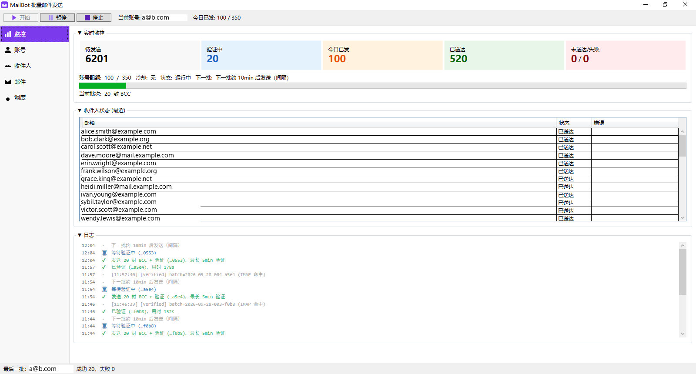
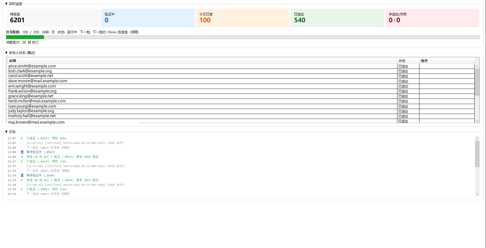
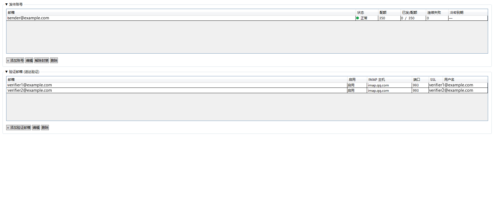
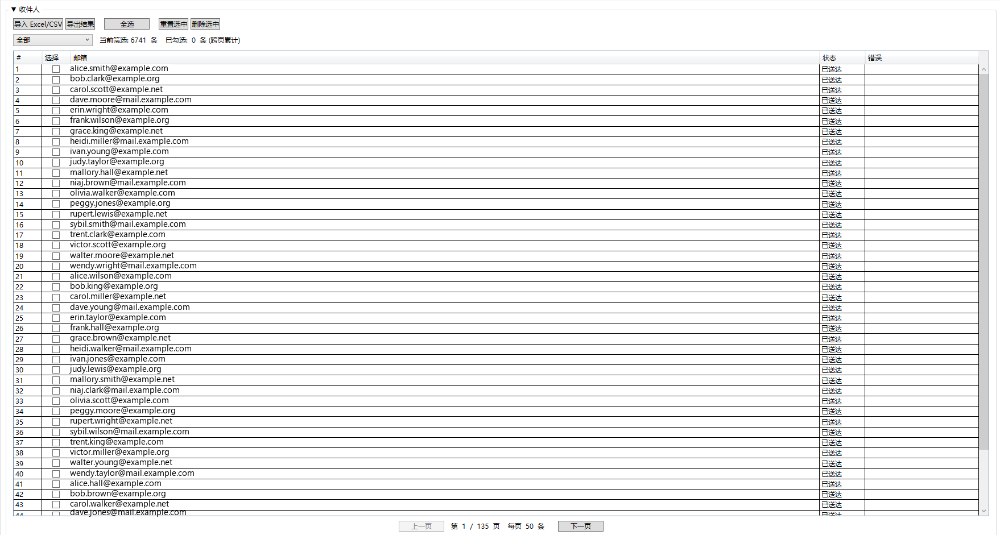
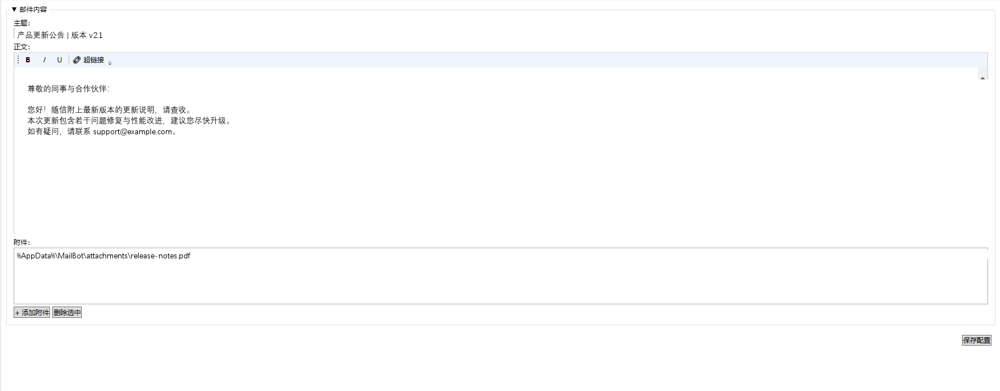
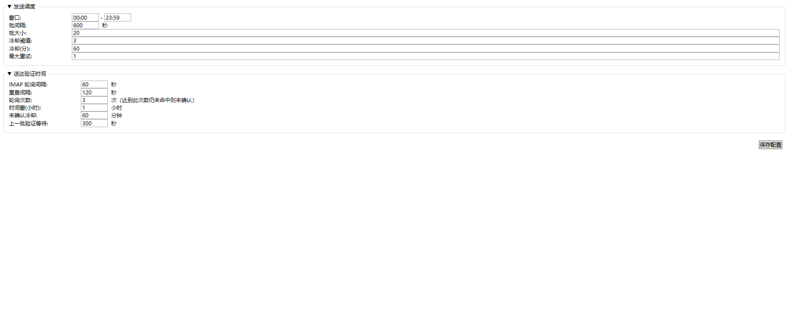

# MailBot

> **面向运营/业务方的批量邮件发送工具** —— WPF 桌面应用，单/多 SMTP 账号轮询、BCC 批量发送、定时调度、自动风控切换、送达验证、状态持久化。



---

## 目录

- [这是什么](#这是什么)
- [核心特性](#核心特性)
- [快速上手](#快速上手)
- [使用文档](#使用文档)
- [运维与配置](#运维与配置)
- [开发与构建](#开发与构建)
- [目录结构](#目录结构)
- [安全提示](#安全提示)
- [已知约束](#已知约束)

---

## 这是什么

MailBot 是一个 Windows 桌面应用（.NET 10 + WPF），用于**通过自有 SMTP 账号批量发送邮件**，并通过**送达验证**（IMAP 轮询）确认邮件确实被收件方服务器接收，避免被反垃圾系统拦截后空跑配额。

它不是群发营销 SaaS，不依赖外部 SMTP 中转，每一封邮件都从你配置的某个发件账号直接发到收件人的邮件服务器。

## 核心特性

- **单窗口 + 5 个页面**：监控 / 账号 / 收件人 / 邮件 / 调度，所有操作在一个窗口里完成。
- **多发件账号轮询**：配置多个发件账号，系统按"剩余配额降序 + 排除被封/冷却中"自动挑选当前最佳账号。
- **BCC 批量发送**：每批 20 封左右（同封 BCC），降低 SMTP 连接次数、减少被识别为群发的概率。
- **送达验证**：在 BCC 里同时放一个验证邮箱，发送后定时 IMAP 轮询指定时间窗内的邮件；命中即"已送达"，否则回退收件人为 pending 并对发件账号施加冷却。
- **风控自动切换**：连续失败 → 账号进入 cooling（冷却）；超时未送达 → 账号进入 cooling；管理员可手动 banned / 解除封禁。
- **定时窗口**：可配置发送窗口（如 22:00-06:00 跨天窗口），窗口外自动等待下次起点。
- **状态持久化**：所有数据（账号、收件人、发送日志、配置、配额退额审计）落到本地 SQLite，重启不丢失。
- **托盘常驻 + 单实例**：关闭窗口默认最小化到托盘，托盘菜单可恢复/退出；启动第二实例会让第一实例显示主窗口。
- **DPAPI 密码加密**：SMTP/IMAP 密码使用 Windows 当前用户级 DPAPI 加密落库，不存明文。

## 快速上手

> 详细步骤参见 [docs/quickstart.md](docs/quickstart.md)。下面是最短路径：

1. 启动 `MailBot.App.exe`（首次启动会在 `%AppData%\MailBot\` 下创建 `mailbot.db`）。
2. **账号** 页 → 添加 1 个发件账号（SMTP）+ 1 个验证邮箱（IMAP，QQ 邮箱此处填授权码）。
3. **收件人** 页 → 导入 Excel/CSV 收件人文件（UTF-8/GBK，含 `email` 列）。
4. **邮件** 页 → 填写主题、HTML 正文（富文本编辑）、可选附件。
6. **调度** 页 → 确认默认参数后点 "保存配置"。
5. 顶部工具栏点 **开始** → 切换到 **监控** 页查看实时进度和日志。

## 使用文档

| 文档 | 适用人群 | 内容 |
|---|---|---|
| [docs/quickstart.md](docs/quickstart.md) | 首次使用 | 9 步流程 + 6 张界面截图 |
| [docs/accounts.md](docs/accounts.md) | 账号配置 | 发件账号/验证邮箱字段、SMTP/IMAP、SSL、QQ 邮箱授权码、状态机 |
| [docs/recipients.md](docs/recipients.md) | 收件人管理 | Excel/CSV 导入导出（编码）、分页、筛选、跨页勾选、状态机 |
| [docs/compose.md](docs/compose.md) | 邮件编辑 | 富文本编辑器、附件管理、模板校验 |
| [docs/schedule.md](docs/schedule.md) | 调度参数 | 发送窗口/批间隔/批大小/冷却 + 送达验证全部字段含义与默认值 |
| [docs/monitoring.md](docs/monitoring.md) | 监控与日志 | 5 个统计指标含义、日志符号、托盘和单实例行为 |
| [docs/faq.md](docs/faq.md) | 故障排查 | DPAPI 失效、SMTP 认证失败、QQ 授权码、SSL 端口、托盘消失等 |
| [docs/development.md](docs/development.md) | 开发者 | 构建、测试、模块说明、数据目录、Schema 迁移、IconGen 工具 |

## 运维与配置

- **数据库位置**：默认 `%AppData%\MailBot\mailbot.db`（首次启动自动创建）。
- **覆盖数据库路径**（按优先级）：
  1. 命令行 `--db <path>`
  2. 环境变量 `MAILBOT_DB_PATH`
  3. exe 同目录的 `mailbot.config.json`（`{"DatabasePath": "..."}`，支持 `%AppData%` 环境变量展开）
  4. 嵌入在 MailBot.Core.dll 内的默认配置
- **日志文件**：`<db 父目录>/logs/mailbot-yyyy-MM-dd.log`（每天一份，UTF-8，线程安全）。
- **附件副本**：`<db 父目录>/attachments/`（原文件被删除/移动不影响已发送邮件）。
- **Schema 迁移**：首次启动会为已存在的旧库自动补字段（`recipients.batch_id / verified_at / pending_retry_at / unconfirmed_count`，`senders.trust_invalid_certificate`），不需要手动操作。

## 开发与构建

> 详细步骤参见 [docs/development.md](docs/development.md)。下面是速查。

```bash
# 环境要求：.NET 10 SDK、Windows（WinForms + WPF）

# 还原 + 构建整个解决方案
cd src
dotnet restore
dotnet build MailBot.sln

# 运行 WPF 应用
dotnet run --project MailBot.App/MailBot.App.csproj

# 运行测试（xUnit，约 100+ 用例）
dotnet test MailBot.Tests/MailBot.Tests.csproj

# 重新生成应用图标（可选；修改了 IconGen/ 后执行）
dotnet run --project ../scripts/IconGen/IconGen.csproj
```

依赖的 NuGet 包：CommunityToolkit.Mvvm、MailKit/MimeKit、Microsoft.Data.Sqlite、CsvHelper、EPPlus、xUnit。

## 目录结构

```
MailBot/
├── README.md                ← 本文件
├── docs/                    ← 使用文档 + 设计文档
│   ├── quickstart.md
│   ├── accounts.md
│   ├── recipients.md
│   ├── compose.md
│   ├── schedule.md
│   ├── monitoring.md
│   ├── faq.md
│   ├── development.md
│   └── images/              ← 文档截图
├── scripts/
│   └── IconGen/             ← 应用图标生成工具（独立 .NET 项目）
└── src/
    ├── MailBot.sln
    ├── NuGet.Config
    ├── MailBot.App/         ← WPF UI 层（启动项目）
    │   ├── App.xaml(.cs)    ← 应用入口 + 启动流程
    │   ├── MainWindow.xaml(.cs)
    │   ├── Views/           ← 页面 + 对话框
    │   ├── ViewModels/      ← MVVM
    │   ├── Controls/        ← 自定义控件
    │   ├── Converters/      ← XAML 值转换
    │   └── Logging/         ← UI 日志桥接
    ├── MailBot.Core/        ← 业务逻辑（无 UI 依赖，可独立引用）
    │   ├── Logging/         ← 日志接口
    │   ├── Mail/            ← MimeMessage 装配 + 模板校验
    │   ├── Models/          ← 实体
    │   ├── Recipients/      ← 收件人导入/导出/状态
    │   ├── Scheduling/      ← 时间窗口/配额重置
    │   ├── Security/        ← DPAPI 密码加密
    │   ├── Senders/         ← 发件账号池 + 状态机
    │   ├── Sending/         ← SMTP 调度、批次组装、配额退额
    │   ├── Storage/         ← SQLite + 仓储 + 附件/日志落盘
    │   └── Verification/    ← IMAP 轮询 + 批次追踪 + 验证配置
    └── MailBot.Tests/       ← xUnit 测试（覆盖所有 Core 模块）
```

## 安全提示

⚠️ **DPAPI 密码加密只对当前 Windows 用户有效**。如果发生以下情况，所有发件/验证账号的密码都会变成无法解密的密文，必须重新添加：

- 把 `%AppData%\MailBot\` 目录从一台机器复制到另一台机器
- 用另一个 Windows 用户登录同一台机器
- 重装 Windows / 切换到新域账号

数据库文件本身不需要导出密码字段，但 **复制数据库到其他机器不会有任何价值** —— 启动时会因解密失败报 "无法解密凭据" 错误。详见 [docs/faq.md](docs/faq.md)。

## 已知约束

- **仅 Windows**：WPF 应用，需要 Windows 10/11 或 Windows Server。
- **凭据绑定本机 + 当前用户**：见上一节。
- **WAL 模式仅生产路径启用**：测试用的临时数据库不会启用 WAL，避免文件锁。
- **BCC 装配逻辑**：1 个收件人放 To；多个收件人首 To + 其余 BCC；验证邮箱始终进 BCC（不放在 To，避免被识别为群发）。主题不带 `[batch=xxx]` 前缀。
- **IMAP 验证按时间窗**：不再用 UID 水位线，避免水位漂移漏算；重复扫描由批次状态机去重。
- **`SendHoldOnUnverifiedSeconds`**：SendEngine 主循环等上一批送达验证的最长秒数（300s = 5 分钟），避免在 pending 期间连发下一批。
- **`AppConfig.MaxSendAttempts`** 字段存在但 UI 未暴露编辑入口；如需修改请直接编辑 `app_config` 表（key=`max_send_attempts`，默认 3）。

---

## 截图导航

| 主窗口 | 监控页 | 账号页 |
|:---:|:---:|:---:|
|  |  |  |

| 收件人页 | 邮件页 | 调度页 |
|:---:|:---:|:---:|
|  |  |  |"# MailBot" 
